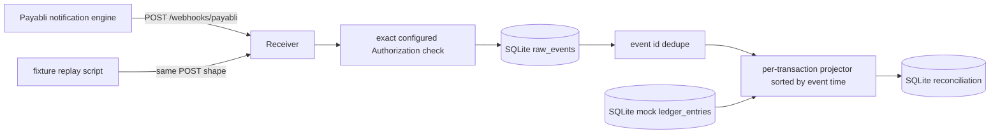

# payabli-reconciler

A small Node 20 + TypeScript service that receives Payabli payment webhooks, stores raw events in SQLite, dedupes retries, tolerates out-of-order delivery, and reconciles payments against a mock ledger.

No Payabli sandbox keys are required or used. Every payload in the replay and test suite is a fixture built from the documented payload shapes at [docs.payabli.com](https://docs.payabli.com/developers/api-reference/webhooks-overview).

## Setup

```bash
npm install
npm test
npm run replay
```

Run the service:

```bash
PAYABLI_WEBHOOK_AUTH='Basic replace-me' \
DATABASE_PATH=reconciler.db \
PORT=3000 \
npm run dev
```

`PAYABLI_WEBHOOK_AUTH` must be the exact `Authorization` value configured in Payabli's `webHeaderParameters` when creating the notification. The receiver exposes `POST /webhooks/payabli`. Reconciliation output is read from SQLite by the replay script rather than through an unauthenticated admin endpoint.

## Architecture



The design is deliberately small:

1. Authenticate and parse the webhook.
2. Store the exact raw body first.
3. Dedupe before doing any reconciliation work.
4. Rebuild the transaction's reconciliation state from stored events ordered by `transTime` or `chargebackTime`, not arrival order.
5. Compare the latest approval with rows in the mock ledger.

## Reconciliation statuses

| Status | Meaning |
|---|---|
| `matched` | One approval, one ledger row, same `TotalAmount` in integer cents |
| `missing` | Approval exists in webhooks but not in the ledger |
| `duplicate` | Multiple ledger rows or multiple distinct approval events for the transaction |
| `amount_mismatch` | Approval and ledger amounts differ, or webhook amount cannot be parsed |
| `refund` | A `RefundedPayment` event exists for the transaction |
| `chargeback` | A `ReceivedChargeBack` event exists for the transaction |

Refund and chargeback currently take precedence over amount/duplicate details because those are the operationally important final states. The detail string still reports ledger-row counts.

## Event ids and dedupe

Payabli's documented payment payloads do not include a unique delivery/event id. The service therefore:

1. uses `eventId`, `EventId`, `notificationId`, or `NotificationId` if one is present; otherwise
2. derives a stable id from the SHA-256 hash of canonicalized JSON.

Exact retries dedupe even if JSON key order changes. If Payabli retries with mutated payload content and no real event id, there is no documented way to know those deliveries are the same event; that case becomes a distinct event and can be surfaced as `duplicate` for repeated approvals.

## Replay

```bash
npm run replay
```

The replay script creates a fresh `reconciler.replay.db`, seeds a mock ledger, starts the real HTTP service on an ephemeral port, and posts a fixture sequence containing:

- an exact retry, delivered twice
- an amount mismatch
- a transaction duplicated in the ledger
- a transaction missing from the ledger
- a late refund for an earlier approval
- a chargeback delivered before its original approval

It prints one line per delivery, the reconciliation table, a summary count, raw stored-event count, and ignored duplicate-delivery count.

## edge cases i hit in the docs

- **No webhook signature scheme is documented.** I found no HMAC algorithm, signing secret, signature header, timestamp tolerance, or signed payload format in the webhook docs. The only documented authentication mechanism is configuring custom headers through `webHeaderParameters`; the docs' example is `Authorization: Basic AD4566F3S2T76901`. This repo implements that documented mechanism as an exact constant-time comparison. It does not invent an undocumented HMAC scheme.
- **No event or delivery id is documented.** Payment payloads have `Event` and `transId`, but no unique notification id. Dedupe therefore needs the documented-shape fallback hash described above.
- **No ordering or version field is documented.** `ApprovedPayment` and `RefundedPayment` have `transTime`; chargebacks have `chargebackTime`. There is no sequence number, and the docs do not say whether these timestamps are authoritative enough to reorder events.
- **Refund identity is ambiguous.** `RefundedPayment` includes both `transId` and `RefundingTransactionId`. I assumed `transId` is the original payment because `RefundingTransactionId` is separately described as the refunding transaction identifier.
- **Amounts are strings without a currency or scale specification.** The examples describe “currency format” but do not define currency code, comma handling, or whether amounts can exceed two decimal places. This service removes commas and parses up to two decimal places into integer cents.
- **Retry documentation is not fully consistent.** The webhooks overview says non-200 delivery is sent “several times”; the notifications guide says Payabli waits 5 minutes and retries up to 2 times before marking delivery failed.
- **The documented response headers include `String: string`.** That appears to be a placeholder or documentation artifact, not a usable signature or validation header.
- **Receiver-side validation semantics are unspecified.** Payload pages mark many fields required, but the docs do not say whether receivers should reject incomplete notifications. This service validates only the fields needed for safe storage and reconciliation (`Event` and `transId`) and preserves everything else raw.
- **No sandbox keys were available.** The project runs fully on fixtures constructed from the documented `ApprovedPayment`, `RefundedPayment`, and `ReceivedChargeBack` payload shapes.

Useful documentation pages:

- [Webhooks overview](https://docs.payabli.com/developers/api-reference/webhooks-overview)
- [Notifications and reports overview](https://docs.payabli.com/guides/pay-ops-notifications-webhooks-overview.mdx)
- [Payment Approved payload](https://docs.payabli.com/developers/webhooks/payin-payment-approved)
- [Payment Refunded payload](https://docs.payabli.com/developers/webhooks/payin-payment-refunded)
- [Chargeback Received payload](https://docs.payabli.com/developers/webhooks/payops-chargeback-received)
